# Installing Time Converter on an Android phone

Time Converter isn't in the Google Play Store. Instead you install a small free
app called **Obtainium**, which fetches Time Converter for you and tells you
when there's a new version, like a mini app store with just one app in it.

It takes about ten minutes, once. After that, updates are a notification and a
tap.

You'll need: the phone, Wi-Fi, and about 100 MB of free space.

The pictures below come from a test phone, so your screens may look slightly
different. The words on the buttons should be the same.

---

## Part 1: Install Obtainium

**1. Open the Obtainium download page.** On the phone, open Chrome (or your
usual browser) and go to:

> **https://github.com/ImranR98/Obtainium/releases/latest**

Scroll down past the list of changes to the section called **Assets**. It's a
long list of files. Tap the one called exactly **`app-release.apk`** (about
90 MB, near the bottom). Ignore all the others.

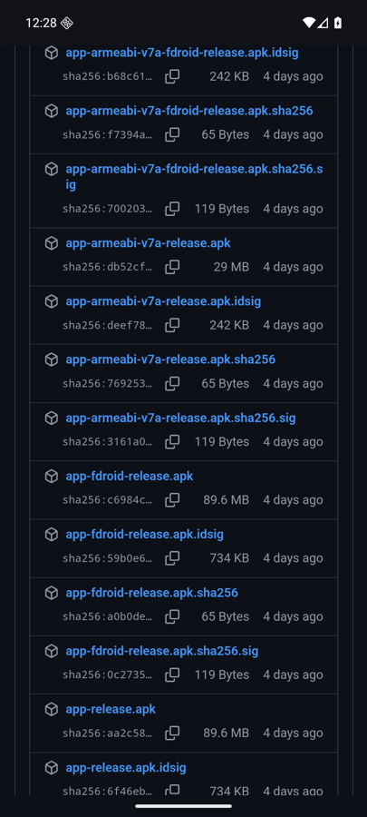

If the browser asks whether you want to keep or download the file, say yes.
When it has finished downloading, tap **Open** (or find it under Downloads in
the browser's ⋮ menu and tap it).

**2. Let the browser install apps.** The first time, the phone says it isn't
allowed to install apps from this source. Tap **Settings**.

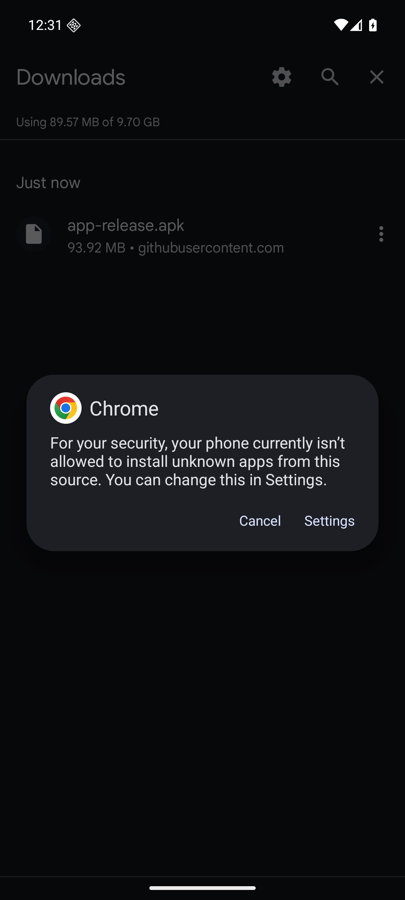

Turn on **Allow from this source**, then tap the back arrow at the top left.

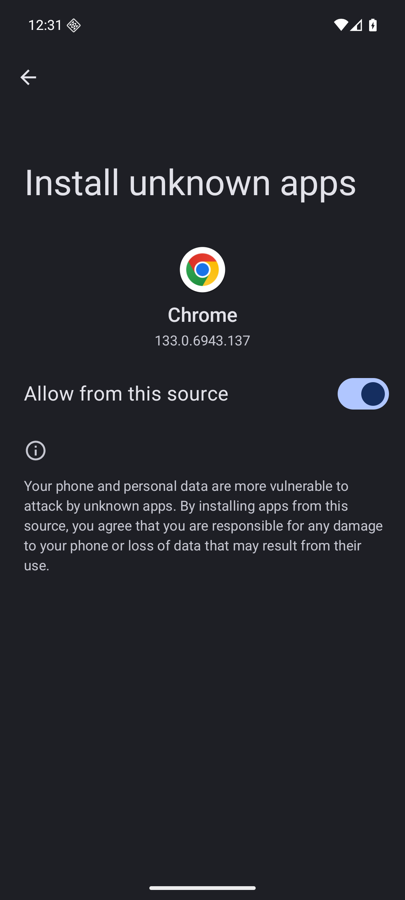

**3. Install Obtainium.** Tap **Install**. (If nothing appears after going
back, tap the downloaded file again.)

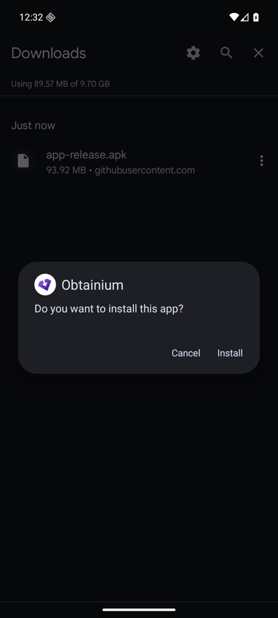

If a **Google Play Protect** box appears saying the app is from an unknown
developer or hasn't been scanned, tap **More details** and then **Install
anyway**. (Or **Scan app** first if offered: that's fine too.) See "If something
looks scary" below.

When it says **App installed**, tap **Open**.

---

## Part 2: Add Time Converter in Obtainium

**4. First-time messages.** Obtainium asks to send notifications: tap
**Allow** (that's how it tells you about updates). Then it shows a
**Welcome** box and a long **Note** about Google. Tap **Okay** on both.

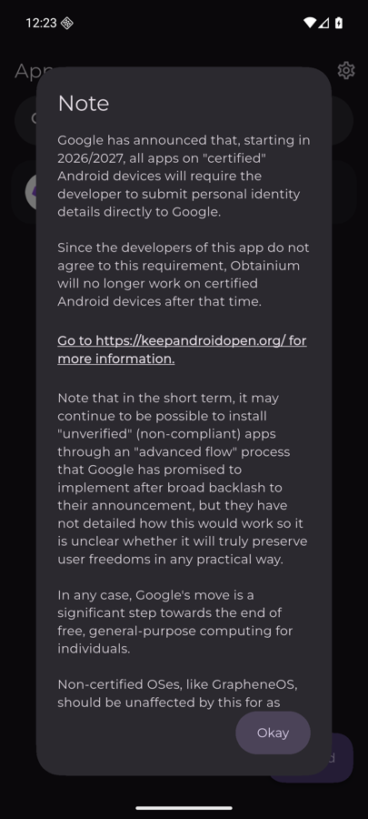

**5. Add the app.** Tap **+ Add** at the bottom right. In the box at the top,
**App source URL**, type:

> **https://github.com/thisolivier/timeConverter**

Leave everything else as it is (in particular, leave **Include
prereleases** switched off). Tap the **+** at the right-hand end of the box you
typed in.

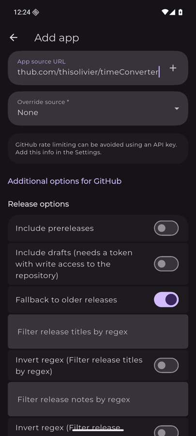

**6. Install Time Converter.** Obtainium finds the latest version (something
like `android-0.1.0.17`). Tap **Install** at the bottom right.

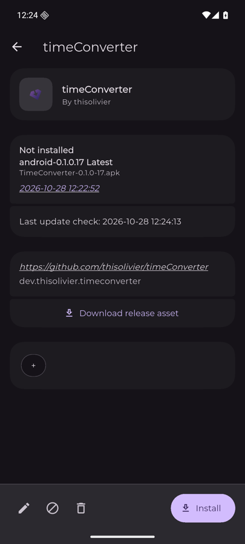

**7. Let Obtainium install apps.** Just like the browser earlier, the phone
asks once. Turn on **Allow from this source**, then tap the back arrow.

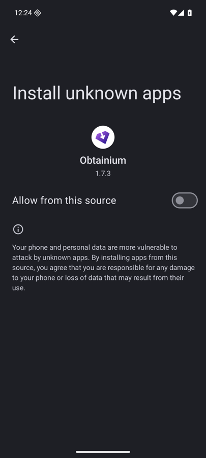

**8. Confirm.** Tap **Install**. (Play Protect may appear again: same answer
as before.)

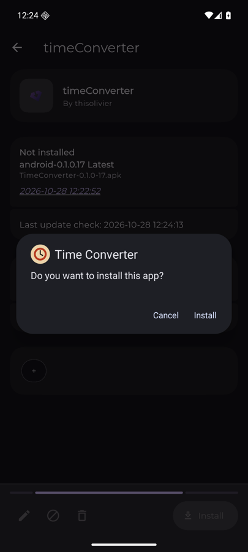

**Done.** Time Converter is now in Obtainium's list and on your home screen
like any other app.

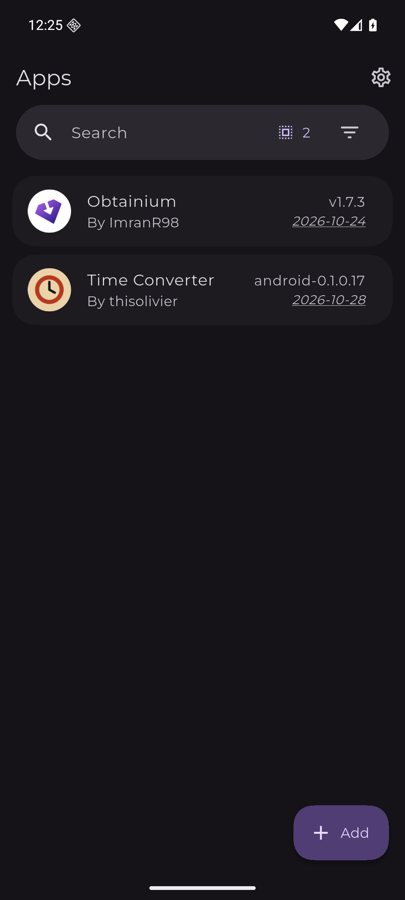
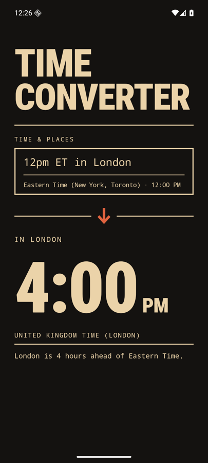

---

## What an update looks like

When there's a new version, Obtainium shows a notification. (It checks by
itself in the background from time to time; opening Obtainium also checks.)

Tap the notification, or open Obtainium and tap **Time Converter**. It shows
the version you have and the newer one, with an **Update** button:

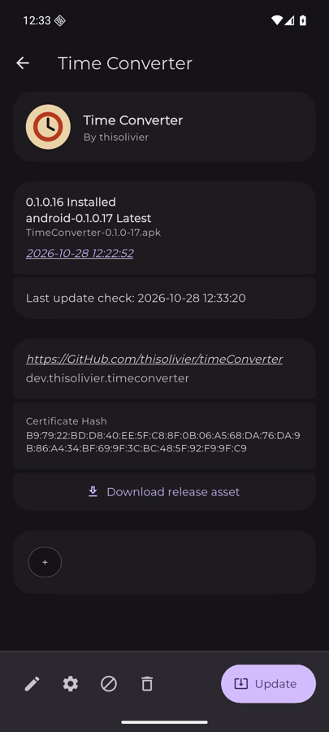

Tap **Update**, then **Update** again on the phone's own question:

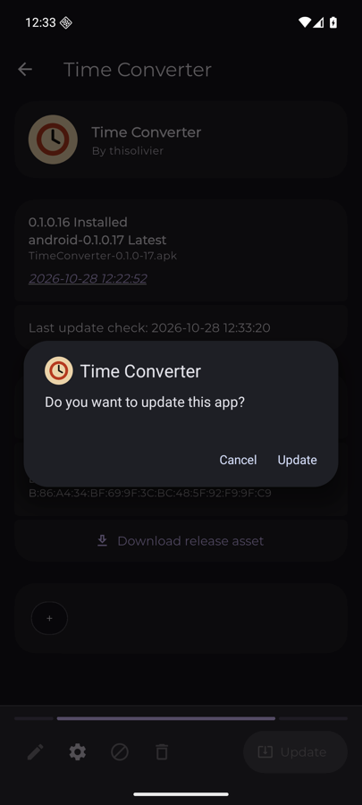

That's it. Your app stays where it is and nothing is lost.

---

## If something looks scary

These warnings are normal for apps that don't come from the Play Store. They
don't mean anything is wrong.

- **"Install unknown apps" / "your phone and personal data are more
  vulnerable".** Android says this about every app from outside the Play
  Store. You're only allowing the browser and Obtainium, and you can switch it
  off again in Settings → Apps → Special app access → Install unknown apps
  whenever you like.
- **Google Play Protect: "unknown developer" or "app not scanned".** Play
  Protect doesn't know Olivier as a developer because he hasn't registered
  with Google. Tap **More details → Install anyway**. It may say this on
  updates too.
- **Obtainium's long "Note" about Google requiring developers to register
  (2026/2027).** This is about a future change to Android. Today it changes
  nothing. If a day comes when the phone refuses to install updates, Olivier
  will help switch on a one-time setting for it.
- **"App not installed" or "conflicts with an existing package" on an
  update.** Don't uninstall anything. Tell Olivier. It means something
  went wrong on his side, and uninstalling would lose the app's data.

Anything else odd: take a screenshot and send it to Olivier.
